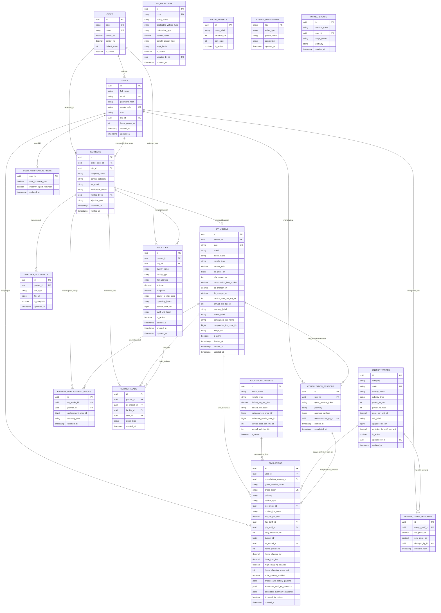

# Validasi & Rancangan Basis Data (`DATABASE_DESIGN.md`) MobilitiQ (Tervalidasi Final)

> **Target *Stack* Terkunci**: **PostgreSQL 16+**, **Prisma ORM**, dan **Node.js + Express (TypeScript)**.
> **Catatan Batas Cakupan**: Skema 18 entitas di bawah telah divalidasi mencakup 100% kebutuhan PBI yang teridentifikasi (`KEL2-54`, `KEL2-57`, `KEL2-67`, `KEL2-69`, `KEL2-71`, `KEL2-73`) serta seluruh 29 layar produk pada *prototype*. Apabila dari papan Jira nantinya ditemukan PBI `Belum diketahui` yang memiliki atribut bisnis di luar *prototype*, skema Prisma akan ditambah melalui migrasi aditif sebelum PBI tersebut dikodekan.

---

## 1. Hasil Validasi terhadap Rancangan Awal 13 Entitas

Pemeriksaan ulang membuktikan bahwa **13 entitas awal BELUM cukup** karena masih menyisakan celah integritas historis, kunci asing implisit, dan konstanta *hardcoded*. Lima perbaikan struktural berikut diterapkan sehingga menjadi **18 Entitas Tervalidasi**:

1. **Penambahan Data Historis Tarif (`energy_tariff_histories`) untuk `KEL2-69`**:
   - Sebelumnya `energy_tariffs` hanya ditimpa (`UPDATE`) tanpa jejak audit. Kini setiap perubahan harga BBM, TDL PLN, atau tarif acuan SPKLU wajib menulis baris baru ke `energy_tariff_histories` (`old_price_idr`, `new_price_idr`, `changed_by_id`, `effective_from`).
2. **Perbaikan Kunci Asing Eksplisit, *Soft Delete*, & *Snapshot* Historis Simulasi (`simulations`, `ev_models`, `facilities`)**:
   - Ditambahkan FK eksplisit `consultation_session_id`, `fuel_tariff_id`, `pln_tariff_id`, dan `city_id` pada `simulations`.
   - Ditambahkan kolom `immutable_tariff_ev_snapshot` (`Json`) pada `simulations` untuk mengunci harga BBM, tarif PLN, dan spesifikasi/harga EV tepat pada detik simulasi disimpan agar laporan PDF (`20`) dan Riwayat (`21`) tidak berubah secara retroaktif ketika tarif `KEL2-69` atau harga katalog `KEL2-57` berubah di kemudian hari.
   - Ditambahkan kolom `deleted_at` (*soft-delete*) + aturan FK `ON DELETE RESTRICT` pada `ev_models` dan `facilities` agar penghapusan katalog/lokasi oleh Mitra tidak merusak integritas riwayat simulasi pengguna.
3. **Eliminasi Kota *Hardcoded* dengan Tabel `cities` (`KEL2-71`, Layar `01, 19, 20, 21, 24`)**:
   - Menyimpan nama kota, provinsi, serta koordinat pusat peta (`center_lat`, `center_lng`, `default_zoom`) untuk inisialisasi viewport **React-Leaflet**, dropdown domisili pengguna, lokasi mitra, dan penghitungan statistik `"N kota"` secara dinamis di halaman Landing (`01`).
4. **Eliminasi Preset Rute & Konstanta Rumus *Hardcoded* (`route_presets` & `system_parameters`)**:
   - `route_presets` menyimpan daftar rute perjalanan Layar `16` (`Kantor harian 38 km`, `Surabaya-Malang 95 km`, dst.).
   - `system_parameters` menyimpan seluruh koefisien teknis & finansial yang sebelumnya *hardcoded* di kode *prototype* (faktor daya PLN `0.85`, efisiensi charger `0.90`, pengali beban malam `0.40`, laju degradasi `ac/mix/dc`, ambang garansi SoH `70%`, bunga deposito `4%`, harga sel baterai acuan/kWh, faktor koreksi WLTP `0.82`, penalti kondisi berkendara, emisi PLTS `0.05 kg/kWh`, serapan pohon `21 kg/th`, proporsi servis BBM `35/40/25%`). Biaya resmi tambah daya PLN juga disimpan pada kolom `upgrade_fee_idr` di `energy_tariffs` (`category = 'PLN'`), dan biaya servis EV/km disimpan langsung pada `ev_models.service_cost_per_km_idr`.
5. **Pemisahan *Event* Corong Analitik (`funnel_events`) dari `consultation_sessions` (Layar `01` & `26`)**:
   - Memungkinkan pencatatan tahap ke-1 corong Superadmin (`Kunjungan landing`) sejak halaman `/` dibuka sebelum pengunjung memilih jalur konsultasi.

---

## 2. Diagram Relasi Entitas Tervalidasi (18 Entitas)

---

## 3. Aturan *Foreign Key* & Integritas Referensial Prisma

| Relasi Anak -> Induk | Aksi `onDelete` | Alasan Integritas Data |
| :--- | :--- | :--- |
| `user_notification_prefs.user_id -> users.id` | `CASCADE` | Preferensi melekat eksklusif pada akun pengguna. |
| `partner_documents.partner_id -> partners.id` | `CASCADE` | Dokumen legalitas adalah sub-entitas langsung pendaftaran mitra. |
| `simulations.ev_model_id -> ev_models.id` | `RESTRICT` | Mencegah penghapusan fisik unit EV yang sudah pernah dipakai dalam riwayat simulasi; penghapusan katalog wajib memakai `deleted_at` (*soft-delete*). |
| `simulations.fuel_tariff_id` & `pln_tariff_id -> energy_tariffs.id` | `RESTRICT` | Menjaga jejak acuan tarif yang dipakai saat simulasi dihitung. |
| `simulations.user_id -> users.id` | `SET NULL` | Menjaga konsistensi agregat statistik anonim bila akun pengguna dihapus, atau `CASCADE` bila pengguna meminta penghapusan data pribadi penuh. |
| `energy_tariff_histories.energy_tariff_id -> energy_tariffs.id` | `RESTRICT` | Riwayat audit tarif energi (`KEL2-69`) tidak boleh terhapus. |
| `ev_models.partner_id -> partners.id` (*nullable*) | `SET NULL` | Mendukung unit katalog bawaan platform (`partner_id = NULL`) maupun unit milik mitra spesifik. |
| `partners.verified_by_id`, `energy_tariffs.updated_by_id` -> `users.id` | `SET NULL` | Audit admin tetap aman walaupun akun admin diganti di masa depan. |

---

## 4. Matriks Sumber Data Seluruh Fitur (Verifikasi 0% Data Bisnis *Hardcoded*)

| Layar & Fitur | Data yang Sebelumnya *Hardcoded* di *Prototype* | Sumber Tabel & Kolom Resmi di PostgreSQL |
| :--- | :--- | :--- |
| **`01` Landing** (3 statistik pita & simulasi contoh) | `"Rp 377 rb"`, `"12.480"`, `"3 kota"` | `AVG` penghematan dari `simulations`, `COUNT(*)` `consultation_sessions` selesai, `COUNT(*)` `cities` aktif dengan `facilities` aktif. |
| **`03` Chatbot Konsultasi** (`Jalur A` & `Jalur B`) | Array 6 motor/mobil BBM `se` & 9 EV `w` | `ice_vehicle_presets` (`is_active=true`), `energy_tariffs` (`category='BBM'`), `ev_models` (`is_active=true, deleted_at IS NULL`). |
| **`08` Kalkulator BBM** (**`KEL2-54` & `KEL2-73`**) | Harga BBM `ee`, servis `47/230`, pajak `400rb/3.5jt`, porsi servis `35/40/25%` | `energy_tariffs`, `ice_vehicle_presets` (`service_cost_per_km_idr`, `annual_stnk_tax_idr`), `system_parameters` (`ice_oil_share`, `ice_periodic_share`, `ice_tire_brake_share`). |
| **`09` Simulator Energi EV** (**`KEL2-67`**) | Tarif tunggal PLN `1444.7`, SPKLU `2466`, servis EV `14/89` | `energy_tariffs` (`PLN` dicocokkan dengan `home_power_va` pengguna + `SPKLU_REF`), `ev_models` (`consumption_kwh_100km`, `service_cost_per_km_idr`). |
| **`10, 11, 23` Katalog & Komparasi EV** (**`KEL2-57`**) | Array `w` (9 unit) & `w.slice(0,7)` | `ev_models` difilter berdasarkan status `is_active`, `deleted_at IS NULL`, dan `partner_id` (khusus Layar `23`). |
| **`12, 28` Pembelian Awal & Insentif** | Potongan PPN DTP `10%` & subsidi `Rp 5 jt` statis | `ev_incentives` (`is_active=true`, `calculation_type`, `benefit_value`). |
| **`13, 14, 25` Baterai & Sinking Fund** | Degradasi `2.0/2.9/3.9%`, ambang `70%`, harga baterai `3.5jt/2.2jt`, bunga `4%` | `battery_replacement_prices` (per unit EV) dengan *fallback* ke `system_parameters`. |
| **`15` Home Charging Planner** | Faktor daya `1.0`, biaya naik daya `1.15jt/2.05jt/3.9jt`, pengali malam `0.4` | `energy_tariffs` (`upgrade_fee_idr` per golongan VA), `system_parameters` (`pln_power_factor=0.85`, `charger_efficiency=0.90`, `night_load_factor=0.40`). |
| **`16` Simulator Jarak Tempuh** | 4 tombol rute perjalanan, faktor `0.82`, penalti `-10/-8/-7%` | `route_presets` (`is_active=true` diurutkan `sort_order`), `system_parameters`. |
| **`17` TCO 5 Tahun & Payback** | Nilai jual kembali `12jt/110jt`, pajak, dan dana baterai statis | `ice_vehicle_presets.estimated_resale_price_idr`, `ev_models`, `ev_incentives`, dan parameter tersinkron di `simulations`. |
| **`18` Kalkulator Emisi** | Emisi BBM `2.28/2.30/2.68`, PLN `0.87`, PLTS `0.05`, pohon `21` | `energy_tariffs.emission_kg_co2_per_unit` + `system_parameters` (`rooftop_solar_emission`, `tree_absorption_kg_yr`). |
| **`19, 24, 25` Peta Fasilitas GIS** (**`KEL2-71`**) | 3 kota & 11 lokasi SVG `de`, jarak/menit statis | `cities` (`center_lat/lng`), `facilities` (`latitude, longitude`, `service_tariff_idr`), rumus jarak Haversine di Express API. |
| **`20, 21` Laporan PDF & Riwayat/Profil** | Nama `"Rina Anggraini"`, tanggal `"11 Okt 2026"`, 4 riwayat *dummy*, 3 lokasi Jakarta | `users` + `cities` dari `GET /api/me`, `simulations` (`immutable_tariff_ev_snapshot`, `created_at`), `facilities` difilter berdasarkan `city_id` pengguna. |
| **`22, 26, 29` Portal Mitra & Superadmin** | Seluruh angka KPI, deret grafik, dan 3 pemohon mitra | Agregasi SQL nyata dari `partner_leads`, `funnel_events`, `consultation_sessions`, `partners`, dan `partner_documents`. |

---

## 5. Spesifikasi Endpoint REST API Express (`/api/v1/...`)

- **Auth & Profil (`/api/v1/auth`, `/api/v1/me`)**:
  - `POST /auth/register` (`USER` atau calon `MITRA` + unggah metadata dokumen awal), `POST /auth/login` (klaim otomatis `guest_session_token`), `POST /auth/google`, `POST /auth/logout`, `GET /me`, `PATCH /me`.
- **Bootstrap Parameter Referensi (`/api/v1/reference`)**:
  - `GET /reference/bootstrap` -> mengembalikan `cities`, `energy_tariffs` aktif, `ice_vehicle_presets` aktif, `ev_incentives` aktif, `route_presets` aktif, dan `system_parameters` publik.
- **Katalog & Komparasi EV (`/api/v1/ev-models`, `/api/v1/partner/ev-models` - PBI `KEL2-57`)**:
  - Publik/User: `GET /ev-models`, `GET /ev-models/compare?ids=a,b`, `GET /ev-models/:idOrSlug`.
  - Mitra (`role='MITRA'`): `GET /partner/ev-models`, `POST /partner/ev-models`, `PUT /partner/ev-models/:id`, `PATCH /partner/ev-models/:id/status`, `DELETE /partner/ev-models/:id` (*soft-delete*).
- **Konsultasi, Kalkulasi, Riwayat, & PDF (`/api/v1/consultations`, `/api/v1/simulations` - PBI `KEL2-54, 67, 73`)**:
  - `POST /events/funnel`, `POST /consultations`, `POST /simulations/calculate`, `GET /simulations`, `POST /simulations`, `GET /simulations/:id`, `DELETE /simulations/:id`, `GET /simulations/share/:shareToken`, `GET /simulations/:id/pdf`.
- **Peta Fasilitas & Layanan Mitra (`/api/v1/facilities`, `/api/v1/partner/...` - PBI `KEL2-71`)**:
  - Publik/User: `GET /facilities?city=&type=&q=&lat=&lng=`, `POST /facilities/:id/lead`.
  - Mitra (`role='MITRA'`): `GET /partner/dashboard`, `GET /partner/facilities`, `POST /partner/facilities`, `PUT /partner/facilities/:id`, `DELETE /partner/facilities/:id`, `PUT /partner/service-pricing`.
- **Tata Kelola Superadmin (`/api/v1/admin/...` - PBI `KEL2-69`)**:
  - `GET /admin/analytics`, `GET /admin/energy-tariffs`, `PUT /admin/energy-tariffs` (transaksional menulis ke `energy_tariff_histories`), `GET /admin/energy-tariffs/histories`, `GET /admin/incentives`, `POST /admin/incentives`, `PATCH /admin/incentives/:id`, `GET /admin/partners`, `POST /admin/partners/:id/verify`, `PUT /admin/system-parameters`.
