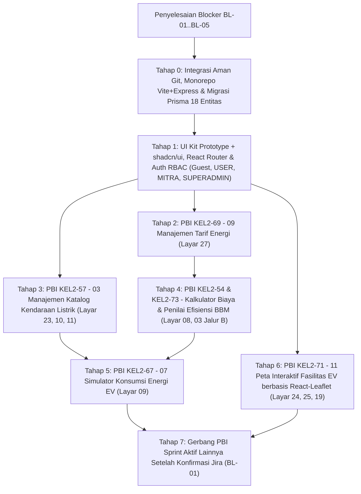

# Rencana Implementasi Final (`IMPLEMENTATION_PLAN.md`) MobilitiQ (Tervalidasi Final)

> **Status Persetujuan**: Dokumen ini merupakan hasil **Final Validation** sebelum penulisan kode dimulai. **Belum ada kode aplikasi, berkas migrasi Prisma, maupun modifikasi terhadap berkas anggota kelompok yang dieksekusi.**

---

## 1. Spesifikasi *Tech Stack* Terkunci (Tanpa Next.js)

Arsitektur awal dibangun menggunakan pemisahan bersih monorepo NPM Workspaces (`client/`, `server/`, `shared/`) dengan mempertahankan semaksimal mungkin aset komponen dari *prototype* Figma Make:

- **Frontend (`client/`)**:
  - **Vite** + **React 19** + **TypeScript**
  - **React Router** (`BrowserRouter`, `<Outlet />`, `<ProtectedRoute allowedRoles={[...]} />`)
  - **Tailwind CSS v4** (mempertahankan seluruh token `@layer theme`, tipografi `Plus Jakarta Sans` + `Inter`, `.num`, animasi `.rise`, dan gaya `input[type=range]` dari `app.css` *prototype*)
  - **shadcn/ui** (`Dialog` untuk *focus-trapped modal* perbaikan `BUG-14`, `AlertDialog` untuk konfirmasi hapus, `Tooltip` grafik, `Sonner` untuk antrean *toast*) yang dipadukan langsung dengan komponen domain *prototype* yang sudah matang (`PublicLayout`, `UserLayout`, `MitraLayout`, `SuperLayout`, `CalculatorSplitLayout`, `PageHeader`, `MetricCard`, `RangeSlider`, `FilterChip`, `ChatBubble`, `QuickWidget`, `HomeLoadGauge`, `VehicleIllustration`, dan grafik SVG ringan)
  - **React-Leaflet** (`leaflet` + OpenStreetMap tiles) untuk peta GIS nyata pada Layar `19` dan `24`
- **Backend (`server/`)**:
  - **Node.js + Express** + **TypeScript** (`zod` untuk validasi *payload*, autentikasi JWT via HttpOnly Cookie + `bcryptjs`, *middleware* RBAC)
  - **Prisma ORM** (`prisma/schema.prisma`, `prisma/migrations`, `prisma/seed.ts`)
  - **PostgreSQL 16+** (18 entitas relasional tervalidasi pada `DATABASE_DESIGN.md`)
- **Shared (`shared/`)**:
  - Kontrak tipe data TypeScript (`DTO`) dan mesin rumus murni `calculations.ts` yang dipakai bersama oleh `client` dan `server`.

---

## 2. Hasil Validasi Role, Repositori, dan Cakupan PBI

### A. Konsistensi Aktor & *Role* Sistem
- **`Frame 00` (`Design System`)**: Bukan *role* pengguna, melainkan artefak dokumentasi internal pengembang (hanya dimuat saat `import.meta.env.DEV`).
- **4 Aktor Sistem**:
  1. **`Guest` (Tamu Tanpa Akun)**: Pengunjung sesi anonim (`guest_session_token`) pada Layar `01` s.d. `06`.
  2. **`USER` (`users.role = 'USER'`)**: Pengguna terdaftar pada Layar `07` s.d. `21`.
  3. **`MITRA` (`users.role = 'MITRA'`, status bisnis `PENDING | APPROVED | REJECTED` di tabel `partners`)**: Pengelola katalog EV & fasilitas pada Layar `22` s.d. `25`.
  4. **`SUPERADMIN` (`users.role = 'SUPERADMIN'`)**: Pengelola tarif energi nasional, insentif, verifikasi mitra, dan analitik pada Layar `26` s.d. `29`.

### B. Kondisi Setiap *Branch* Anggota & Kode yang Tersedia
| Branch | Commit Terakhir | Status Merge ke `origin/main` | Isi Berkas Saat Ini | Ketersediaan Kode Aplikasi |
| :--- | :---: | :--- | :--- | :---: |
| `origin/main` | `291e2d6` | Branch utama jarak jauh (memuat PR #2, #3, #4, #5) | `01 - Kalkulator Biaya BBM.txt`, `03 - Manajemen Katalog Kendaraan Listrik.txt`, `KEL2-69.txt`, `Peta Interaktif Fasilitas EV.txt`, `NamaAnggota.txt` | **0%** |
| `main` (lokal) | `803232c` | Tertinggal 4 PR di belakang `origin/main` | `NamaAnggota.txt` (kosong) | **0%** |
| `Raihan_Branch` (`HEAD` lokal & `origin`) | `2666be0` | **Belum *merged*** (`PR #1` masih terbuka, bercabang dari `803232c`) | `03 - Penilai Efisiensi BBM Kendaraan Konvensional.txt`, `08 - Simulator Konsumsi Energi EV.txt`, `KEL2-67.txt`, `NamaAnggota.txt` (6 nama anggota) | **0%** |
| `origin/Najwa_Branch` | `d784d2a` | Sudah *merged* (`PR #2`) | Berkas `.txt` (`KEL2-71`) | **0%** |
| `origin/Fitri_branch` | `93070df` | Sudah *merged* (`PR #3`) | Berkas `.txt` (`KEL2-69`) | **0%** |
| `origin/Fadli_Branch` | `9c490fd` | Sudah *merged* (`PR #4`) | Berkas `.txt` (`KEL2-57`) | **0%** |
| `origin/Salsa_Branch` & `origin/Salsa_branch` | `97d8c56` & `7e5a9ac` | Sudah *merged* (`PR #5`); **terjadi tabrakan huruf besar/kecil ref di Windows** | Berkas `.txt` (`KEL2-54`) | **0%** |
| *Branch `Arsyad`* | *Tidak ada* | Belum ada cabang yang dipush ke `origin` | `Belum diketahui` | **0%** |

- **Kode yang Sudah Tersedia & Dapat Digunakan**: Di repositori Git belum terdapat kode aplikasi (`0%`), tetapi dari bundel *prototype* Figma Make telah diekstrak struktur penuh komponen React 19 + TypeScript + Tailwind CSS v4 (`data.ts`, `ui.tsx`, `layouts.tsx`, `screens/public.tsx`, `user1.tsx`, `user2.tsx`, `admin.tsx`, `system.tsx`, `app.css`) yang langsung dapat diadaptasi ke `client/src/` dan `prisma/seed.ts`.

### C. Strategi Integrasi Kode ke Branch Utama (Tanpa Menimpa Pekerjaan Anggota)
1. **Larangan Mutlak Menimpa / Menghapus**: Dilarang melakukan `git push --force`, `git reset --hard` pada cabang bersama, ataupun menghapus ke-7 berkas `.txt` latihan Git/Jira milik anggota kelompok di direktori *root*.
2. **Penyelesaian Aman `PR #1` (`Raihan_Branch` <-> `origin/main`)**:
   - Perbarui `main` lokal dengan `git checkout main && git merge --ff-only origin/main`.
   - Gabungkan `origin/main` ke `Raihan_Branch` (atau buat *branch* integrasi baru dari `origin/main`), pertahankan seluruh berkas `.txt` dari kedua sisi, dan selesaikan konflik `NamaAnggota.txt` secara **gabungan aditif (*union merge*)** yang mencantumkan ke-6 anggota lengkap beserta seluruh NIM yang sudah tercatat (`Ahmad Raihan Arifianza`, `Fitri Novianti`, `Salsa Yusmara`, `Najwa Aulia`, `Fadli Alamsyah`, `Arsyad`).
3. **Isolasi Direktori Kode Aplikasi**: Seluruh kode baru ditempatkan di dalam `client/`, `server/`, `shared/`, dan konfigurasi *root* (`package.json`, `.gitignore`), sehingga tidak pernah berbenturan dengan berkas `.txt` anggota tim.
4. **Alur *Feature Branch* per PBI**: Setiap tahap/PBI dikerjakan pada cabang fitur terpisah yang bercabang dari `origin/main` terbaru (misalnya `feat/foundation-monorepo`, `feat/KEL2-69-energy-tariffs`, `feat/KEL2-57-ev-catalog`, `feat/KEL2-54-73-bbm-calculator`, `feat/KEL2-67-ev-energy-simulator`, `feat/KEL2-71-facilities-map`) dan digabungkan lewat *Pull Request*.

---

## 3. Daftar *Blocker* yang Harus Diselesaikan Sebelum / Saat Memulai Eksekusi

| ID Blocker | Prioritas | Deskripsi Blocker | Dampak Jika Tidak Diselesaikan | Tindakan Penyelesaian |
| :--- | :---: | :--- | :--- | :--- |
| **`BL-01`** | **Kritis** | **Daftar Resmi PBI Sprint Aktif & *Acceptance Criteria* Jira Belum Tersedia**: Baru 6 tiket (`KEL2-54`, `KEL2-57`, `KEL2-67`, `KEL2-69`, `KEL2-71`, `KEL2-73`) yang terdeteksi dari artefak `.txt` Git; tiket `KEL2-*` lainnya (termasuk tugas `Arsyad`, pemisahan cakupan `KEL2-54` vs `KEL2-73`, serta AC resmi Jira) masih `Belum diketahui` dan **tidak dianggap sudah tercakup**. | Risiko ada PBI sprint aktif yang terlewat atau implementasi meleset dari kriteria penilaian dosen/asisten di Jira. | Ekspor/salin daftar tiket *Active Sprint* beserta *Acceptance Criteria* dari papan Jira kelompok sebelum menutup ruang lingkup sprint. |
| **`BL-02`** | **Tinggi** | **Divergensi `Raihan_Branch` dengan `origin/main` (`REPO-01`, `REPO-02`)**: Workspace aktif berada di `Raihan_Branch` yang belum memuat 4 berkas PBI anggota lain di `origin/main` dan memiliki konflik pada `NamaAnggota.txt`. | Memulai kode langsung di `Raihan_Branch` tanpa *merge* `origin/main` akan memicu konflik cabang dan berisiko menimpa berkas anggota lain. | Lakukan *merge* aditif `origin/main` terlebih dahulu pada awal Tahap 0 sebelum membuat kerangka proyek. |
| **`BL-03`** | **Sedang** | **Tabrakan Ref *Case-Insensitive* `Salsa_Branch` vs `Salsa_branch` (`REPO-03`)**: Membuat `git fetch origin` tanpa argumen keluar dengan kode galat `1` di Windows. | Mengganggu skrip Git otomatis pada mesin Windows anggota tim. | Gunakan `git fetch origin main` untuk sinkronisasi lokal, dan minta pemilik branch menghapus salah satu ref duplikat yang sudah *merged* di GitHub. |
| **`BL-04`** | **Tinggi** | **Kesiapan Layanan PostgreSQL & Kredensial `.env`**: Membutuhkan instance PostgreSQL aktif (`DATABASE_URL`), `JWT_SECRET`, dan opsional `GOOGLE_CLIENT_ID` jika login Google OAuth diwajibkan. | Migrasi Prisma (`prisma migrate dev`) dan API Express tidak dapat dijalankan/divalidasi. | Siapkan database PostgreSQL lokal (atau kontainer Docker `postgres:16-alpine`) pada Tahap 0. |
| **`BL-05`** | **Sedang** | **Persetujuan Penambahan *Field* UI yang Hilang di *Prototype***: Penambahan 7 *field* spesifikasi EV di modal Layar `23` (`KEL2-57`), 4 *field* operasional fasilitas di Layar `24` (`KEL2-71`), kolom kata sandi di Modal Login (`06`), dan halaman daftar/unggah dokumen Mitra (`29`). | Tanpa *field* tersebut, unit EV dan lokasi fasilitas yang dibuat Mitra akan memiliki data kosong/rusak di katalog dan peta pengguna (`BUG-10`). | Setujui pelengkapan *field* form tersebut dengan tetap mengikuti gaya komponen *prototype* + `shadcn/ui`. |

---

## 4. Urutan Pengerjaan Seluruh PBI Sprint Aktif & Kriteria Penerimaan

### Tahap 0: Integrasi Aman Repositori, Monorepo Vite + Express, & Prisma PostgreSQL (18 Entitas)
- **Pekerjaan Git, Database, Backend, & Frontend**:
  - Menyelaraskan cabang kerja dari `origin/main` dengan mempertahankan ke-7 berkas `.txt` dan menggabungkan `NamaAnggota.txt` secara utuh (`BL-02`).
  - Menginisialisasi NPM Workspaces (`client/` Vite + React 19 + TS + Tailwind v4 + `shadcn/ui`; `server/` Express + TS + Prisma; `shared/` tipe & rumus).
  - Menulis `prisma/schema.prisma` untuk **18 entitas tervalidasi** dan `prisma/seed.ts` dari dataset awal *prototype* (3 kota berkoordinat GPS, tarif BBM/PLN/SPKLU, 4 insentif, 6 preset BBM, 9 unit EV, 4 rute perjalanan, parameter sistem, 11 fasilitas berkoordinat GPS asli, dan akun uji `USER`, `MITRA` `APPROVED`, `MITRA` `PENDING`, `SUPERADMIN`).
- **Acceptance Criteria Tahap 0**:
  - [ ] Seluruh berkas `.txt` anggota kelompok tetap utuh tanpa pengurangan baris identitas siapa pun.
  - [ ] `npx prisma migrate dev` dan `npx prisma db seed` sukses membangun 18 tabel beserta data awal di PostgreSQL tanpa galat.
  - [ ] Server Express (`server`) dan dev server Vite (`client`) menyala dan terhubung melalui endpoint kesehatan `GET /api/v1/health`.

---

### Tahap 1: Komponen Dasar (*Prototype* + `shadcn/ui`), React Router, & Auth RBAC
- **Cakupan Layar**: Fondasi UI Kit (`00` khusus mode `DEV`), `06` (Modal/Halaman Login & Registrasi), keempat *Layout Shell*, serta halaman `403` / `404`.
- **Database & Backend Express**:
  - Endpoint `POST /api/v1/auth/register`, `POST /api/v1/auth/login`, `POST /api/v1/auth/google`, `POST /api/v1/auth/logout`, `GET /api/v1/me`, serta `GET /api/v1/reference/bootstrap`.
  - Middleware Express `requireAuth` dan `requireRole('USER' | 'MITRA' | 'SUPERADMIN')` + `requireApprovedPartner`.
- **Frontend Vite + React 19**:
  - Memindahkan token `app.css` dan komponen layak pakai dari *prototype*, mengganti `Modal` dengan `shadcn/ui Dialog` (`BUG-14`), menambah `shadcn/ui AlertDialog` & `Sonner`, menghapus `PreviewShell`, menghapus tautan admin dari `PublicFooter` (`BUG-09`), dan memasang `<ProtectedRoute />` di React Router.
- **Acceptance Criteria Tahap 1**:
  - [ ] Pengguna tanpa sesi (`Guest`) ditolak masuk ke rute `/dashboard`, `/mitra/*`, dan `/admin/*`.
  - [ ] Akun `USER`, `MITRA`, dan `SUPERADMIN` masing-masing hanya dapat mengakses portal sesuai perannya (`HTTP 403` di Express & halaman `403` di React Router jika menyilang peran).
  - [ ] Dialog modal mengunci fokus papan ketik (*focus trap*) dan menutup bersih dengan tombol `Escape`.

---

### Tahap 2: Implementasi PBI `KEL2-69` - `09 - Manajemen Tarif Energi`
- **Cakupan Layar**: Layar `27` (`Manajemen Tarif Energi` - `SUPERADMIN`) + suplai data ke `/api/v1/reference/bootstrap`.
- **Database**: Tabel `energy_tariffs` dan `energy_tariff_histories`.
- **Backend Express**: `GET /api/v1/admin/energy-tariffs`, `PUT /api/v1/admin/energy-tariffs` (transaksional Prisma: memperbarui tarif aktif + mencatat `old_price_idr` & `new_price_idr` ke `energy_tariff_histories`), dan `GET /api/v1/admin/energy-tariffs/histories`.
- **Frontend Vite**: Layar `/admin/tarif-energi` dengan tab `Harga BBM` & `Tarif PLN / Acuan SPKLU`, validasi angka positif, indikator `Belum disimpan`, konfirmasi simpan, dan panel riwayat perubahan tarif.
- **Acceptance Criteria PBI `KEL2-69`** *(AC Resmi Jira: `Belum diketahui`)*:
  - [ ] Hanya `SUPERADMIN` yang dapat melihat halaman manajemen tarif dan menyimpan perubahan tarif (`HTTP 403` bagi peran lain).
  - [ ] Input tarif kosong, huruf, nol, atau negatif ditolak dengan pesan validasi yang jelas (`HTTP 422`).
  - [ ] Setiap perubahan tarif yang disimpan memperbarui `energy_tariffs`, menulis baris jejak historis di `energy_tariff_histories`, dan langsung tersaji pada `GET /api/v1/reference/bootstrap`.

---

### Tahap 3: Implementasi PBI `KEL2-57` - `03 - Manajemen Katalog Kendaraan Listrik`
- **Cakupan Layar**: Layar `23` (`Manajemen Katalog EV` - `MITRA`), Layar `10` (`Katalog EV` - `USER`/`Guest`), dan Layar `11` (`Detail & Komparasi EV` - `USER`).
- **Database**: Tabel `ev_models` dan `battery_replacement_prices`.
- **Backend Express**: CRUD Mitra `/api/v1/partner/ev-models` (validasi kepemilikan `partner_id`, status mitra `APPROVED`, dan *soft-delete* `deleted_at`) serta endpoint publik/pengguna `GET /api/v1/ev-models`, `GET /api/v1/ev-models/:idOrSlug`, dan `GET /api/v1/ev-models/compare`.
- **Frontend Vite**:
  - Layar `/mitra/katalog` (`23`) dengan `shadcn/ui Dialog` Tambah/Edit berspesifikasi lengkap, `Switch` status `Aktif/Nonaktif`, dan `shadcn/ui AlertDialog` konfirmasi hapus (`BUG-10`).
  - Layar `/katalog` (`10`) dengan pencarian *debounced*, filter URL (`type`, `maxPrice`, `minKwh`), *EmptyState* reset, dan *sticky compare bar* maksimal 2 unit.
  - Layar `/komparasi` (`11`) dengan tabel perbandingan 8 atribut dan penanda otomatis nilai unggul.
- **Acceptance Criteria PBI `KEL2-57`** *(AC Resmi Jira: `Belum diketahui`)*:
  - [ ] `MITRA` terverifikasi dapat menambah, mengedit seluruh spesifikasi teknis/harga, mengaktifkan/menonaktifkan, dan melakukan *soft-delete* pada unit EV miliknya sendiri, serta ditolak (`HTTP 403`) bila mengakses unit milik mitra lain.
  - [ ] Unit EV yang aktif langsung muncul dan dapat dicari, difilter, serta dibandingkan pada Layar `10` dan `11`.
  - [ ] Unit EV yang dinonaktifkan atau dihapus (*soft-delete*) tidak muncul di katalog pengguna baru tanpa merusak referensi data simulasi historis.

---

### Tahap 4: Implementasi PBI `KEL2-54` (`01 - Kalkulator Biaya BBM`) & PBI `KEL2-73` (`Penilai Efisiensi BBM Kendaraan Konvensional`)
- **Cakupan Layar**: Layar `08` (`Kalkulator BBM & Perawatan`) dan alur evaluasi kendaraan konvensional pada Layar `03` (`Jalur B`).
- **Database**: Membaca `ice_vehicle_presets`, `energy_tariffs` (`category='BBM'`), dan `system_parameters`.
- **Backend Express & Shared**: Modul `shared/calculations.ts` (fungsi `calculateIceCost`) + validasi endpoint `POST /api/v1/simulations/calculate`.
- **Frontend Vite**:
  - `SimulationContext` terpusat yang menjaga input kendaraan BBM & `km/l` pengguna tetap utuh saat unit EV diganti dalam kategori kendaraan yang sama (`perbaikan BUG-03`).
  - Layar `/kalkulator/bbm` (`08`) dengan pemilih preset BBM, *slider* efisiensi `5-60 km/l`, pemilih jenis BBM dari API `KEL2-69`, *slider* jarak harian `5-150 km`, 3 `MetricCard`, `DonutChart` tahunan ber-*tooltip*, dan rincian perawatan bulanan.
- **Acceptance Criteria PBI `KEL2-54` & `KEL2-73`** *(AC Resmi Jira: `Belum diketahui`)*:
  - [ ] Pemilihan preset kendaraan konvensional otomatis mengisi efisiensi `km/l` acuan, dan pengguna dapat mengubah nilai `km/l` secara kustom dalam rentang valid dengan validasi batas bawah/atas.
  - [ ] Perhitungan konsumsi liter, biaya BBM bulanan/tahunan, komponen perawatan (oli, servis berkala, ban/rem), dan pajak STNK menggunakan harga BBM aktif dari database (`KEL2-69`) tanpa angka *hardcoded*.
  - [ ] Nilai `km/l` kustom pengguna tidak ter-reset saat berpindah ke simulator EV dan mengganti model EV bertipe sama (`BUG-03` selesai).

---

### Tahap 5: Implementasi PBI `KEL2-67` - `07 - Simulator Konsumsi Energi EV`
- **Cakupan Layar**: Layar `09` (`Simulator Energi EV`) beserta integrasi metrik energi EV ke `SimulationContext`.
- **Database**: Membaca `ev_models` (`KEL2-57`), `energy_tariffs` (`PLN` per golongan VA & `SPKLU_REF` dari `KEL2-69`), dan menyimpan konfigurasi ke `simulations`.
- **Backend Express & Shared**: Fungsi `calculateEvEnergyAndSavings` di `shared/calculations.ts` + pengujian unit berbagai golongan `VA` (`450 VA` s.d. `>=6.600 VA`) dan skenario `saving < 0`.
- **Frontend Vite**:
  - Layar `/kalkulator/energi-ev` (`09`): pemilih unit EV katalog aktif, *slider* jarak harian, *slider* porsi *home charging* (`0-100%`) yang terikat ke `SimulationContext` (`perbaikan BUG-06`), pencocokan tarif PLN otomatis terhadap `home_power_va` pengguna (`perbaikan BUG-05`), `CompareBarChart` tahan nilai negatif (`perbaikan BUG-04`), dan `DonutChart` porsi biaya rumah vs SPKLU.
- **Acceptance Criteria PBI `KEL2-67`** *(AC Resmi Jira: `Belum diketahui`)*:
  - [ ] Kebutuhan `kWh/bulan`, biaya `Rp/km`, dan total biaya listrik dihitung akurat dari efisiensi `consumption_kwh_100km` unit EV terpilih, porsi *home charging*, tarif PLN sesuai golongan `VA` pengguna, dan tarif SPKLU aktif.
  - [ ] Perubahan porsi *home charging* tersimpan di `SimulationContext` sehingga selisih penghematan konsisten di seluruh layar yang membacanya.
  - [ ] Skenario di mana biaya operasional EV lebih tinggi daripada BBM (`saving < 0`) dirender tanpa kerusakan grafik dan diberi indikator warna/teks biaya lebih mahal yang jujur.

---

### Tahap 6: Implementasi PBI `KEL2-71` - `11 - Peta Interaktif Fasilitas EV`
- **Cakupan Layar**: Layar `19` (`Peta Fasilitas` - `USER`/`Guest`), Layar `24` (`Showroom & Fasilitas` - `MITRA`), dan Layar `25` (`Harga Layanan` - pendukung tarif fasilitas Mitra).
- **Database**: Tabel `cities`, `facilities`, `battery_replacement_prices`, dan `partner_leads`.
- **Backend Express**: `GET /api/v1/facilities` (filter kota, kategori `SPKLU/SPBKLU/Showroom`, pencarian teks `q`, perhitungan jarak Haversine dari `lat, lng`), `POST /api/v1/facilities/:id/lead`, CRUD Mitra `/api/v1/partner/facilities`, serta `PUT /api/v1/partner/service-pricing`.
- **Frontend Vite + React-Leaflet**:
  - Komponen `FacilityMap` berbasis **React-Leaflet + OpenStreetMap** dengan pin berkategori, kontrol zoom aktif, dan tombol `Lokasi Saya` (`perbaikan BUG-11`).
  - Layar `/mitra/fasilitas` (`24`) dengan form lengkap (`Kota`, `Jenis`, `Alamat`, `Spesifikasi Daya/Slot`, `Jam Operasional`, `Tarif Awal`, klik peta untuk memilih `latitude/longitude` asli) + Layar `/mitra/harga-layanan` (`25`).
  - Layar `/peta` (`19`) dengan filter kota dinamis dari tabel `cities`, filter jenis fasilitas, pencarian lokasi, panel detail *desktop*, *bottom sheet* *mobile*, dan tombol `Petunjuk Arah` yang mencatat `partner_leads` lalu membuka Google Maps Directions (`perbaikan BUG-12`).
- **Acceptance Criteria PBI `KEL2-71`** *(AC Resmi Jira: `Belum diketahui`)*:
  - [ ] Peta menampilkan ubin jalan OpenStreetMap nyata dengan interaksi *zoom*, *pan*, dan seleksi pin berkoordinat GPS akurat.
  - [ ] Fasilitas baru atau pembaruan tarif layanan yang disimpan oleh `MITRA` terverifikasi langsung tampil pada peta dan panel detail pengguna (`19`).
  - [ ] Filter kota, filter kategori fasilitas, pencarian kata kunci, *EmptyState* reset filter, serta tombol `Petunjuk Arah` ke Google Maps berfungsi penuh di *desktop* maupun *mobile*.

---

### Tahap 7: Gerbang Validasi & Eksekusi PBI Sprint Aktif Lainnya (`Blocker BL-01`)
> **Peringatan Ketat**: Modul-modul *prototype* di luar 6 tiket di atas (seperti Funnel Konsultasi `01-05`, Kalkulator Pembelian `12`, Degradasi Baterai `13`, Dana Cadangan Baterai `14`, *Home Charging Planner* `15`, Simulator Jarak Tempuh `16`, TCO 5 Tahun `17`, Kalkulator Emisi `18`, Laporan PDF `20`, Riwayat & Profil `21`, Dashboard Mitra `22`, Analitik Superadmin `26`, Insentif EV `28`, dan Verifikasi Mitra `29`) **memiliki rancangan DB & komponen yang sudah disiapkan**, namun **issue key serta kepastian masuk/tidaknya ke Sprint Aktif masih `Belum diketahui`**.

- **Aturan Eksekusi Tahap 7**:
  1. Begitu daftar lengkap PBI *Active Sprint* beserta *Acceptance Criteria* resmi dari Jira dilampirkan (`penyelesaian BL-01`), setiap tiket Jira yang masuk sprint aktif langsung dipetakan ke modul terkait dan dikerjakan sesuai urutan dependensinya (termasuk perbaikan `BUG-01` pada TCO `17`, `BUG-02` & `BUG-08` pada PDF `20`, `BUG-07` faktor daya `0.85` pada `15`, dan `BUG-13` pada `05`).
  2. Apabila di papan Jira ditemukan PBI sprint aktif yang sama sekali belum memiliki layar di *prototype*, desain UI dan migrasinya dibuat menggunakan komponen *prototype* + `shadcn/ui` sebelum dikodekan.
- **Acceptance Criteria Tahap 7**:
  - [ ] 100% *issue key* yang terdaftar pada papan *Active Sprint* Jira kelompok `KEL2` terverifikasi memiliki implementasi *frontend*, *backend*, basis data, dan pengujian yang memenuhi *Acceptance Criteria* resmi Jira masing-masing.
